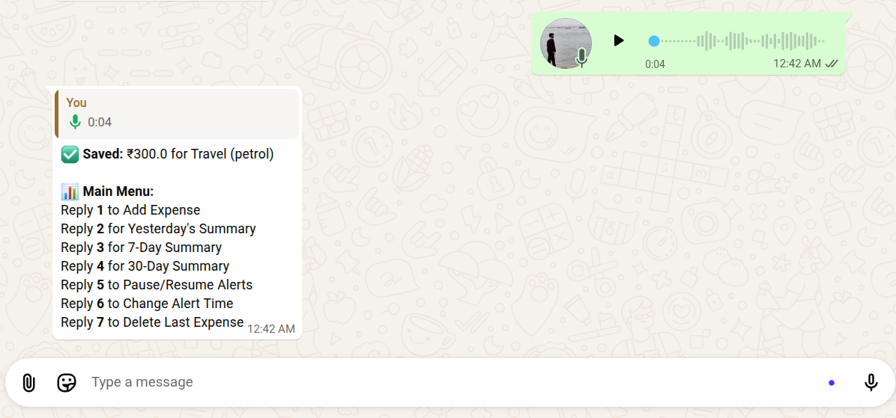
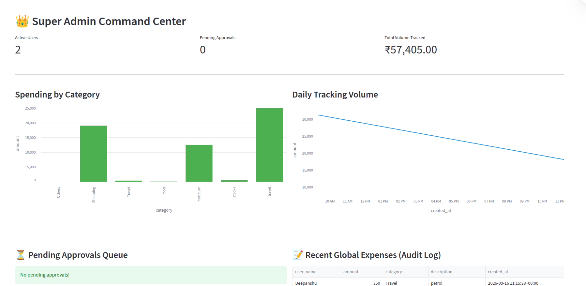

# 🤖 Autonomous Finance Tracker AI Agent

[](https://autonomous-finance-tracker-ai-agent.streamlit.app/)


An intelligent, multimodal WhatsApp-native personal finance tracking agent. It uses advanced LLMs and Speech-to-Text (STT) models to parse conversational expenses from both text messages and voice notes, logs them into a PostgreSQL database, and features an autonomous background agent for automated reporting.

**🔗 [Access the Live Admin Dashboard Here](https://autonomous-finance-tracker-ai-agent.streamlit.app/)**

![WhatsApp Chat Demo]
*Caption: The AI Agent extracting expenses from natural language and displaying the interactive text menu.*


*Caption: Seamless Speech-to-Text processing. Users can simply speak their expenses via voice notes without typing.*

---

## ⚡ Key Features

* **LLM-Powered Extraction:** Log expenses using everyday natural language (e.g., *"Spent 350 on petrol via UPI"*). The TTT model strictly maps unstructured inputs to predefined database categories.
* **Multimodal Inputs (Voice & Text):** Speak or type your expenses. The agent uses Groq's `whisper-large-v3-turbo` for instant Speech-to-Text (STT) transcription of WhatsApp voice notes, feeding seamlessly into the Text-to-Text (TTT) reasoning pipeline.
* **Role-Based Access Control (RBAC):** Multi-tier security (`super_admin`, `admin`, `user`) with state-driven onboarding and in-chat approval workflows.
* **Autonomous Background Scheduler:** A cron-based agent wakes up automatically to calculate and broadcast weekly financial summaries to approved users.
* **Frictionless UI:** Numbered, text-based interactive menus within WhatsApp for quick actions (e.g., fetching summaries, deleting recent logs).
* **Command Center Dashboard:** A Streamlit-based web UI for real-time KPIs, expense visualization, and approval queue management.

![Admin Dashboard]
*Caption: The Super Admin Streamlit dashboard displaying live database metrics and charts.*

---

## 🏗️ System Architecture

This system utilizes a microservices-inspired architecture to separate the messaging gateway from the AI logic.

```text
[WhatsApp User] 
       │ (Meta WebSocket)
       ▼
[Node.js Bridge] ──────► Outbound Gateway (Baileys + useMultiFileAuthState)
       │ ▲               Runs Express on Port 3000 to receive scheduled alerts
       │ │
       │ │ (Path A: Direct Reply / Path B: Scheduled Push)
       ▼ │
[FastAPI Backend] ─────► The Core Agentic System (Port 7860)
       ├── [Access Guard]      (Validates user state and permissions)
       ├── [AI Parser Engine]  (Groq Whisper for STT -> openai/gpt-oss-120b for TTT JSON extraction)
       ├── [Task Scheduler]    (APScheduler cron jobs -> POSTs to Node.js Port 3000)
       └── [Database]          (Supabase/PostgreSQL manages relationships & cascades)
       
[Streamlit UI] ────────► Super Admin Visual Dashboard
```

---

## 🚀 How to Run Locally

### 1. Start the WhatsApp Bridge (Port 3000)
```bash
cd whatsapp-bridge
npm install
node bridge.js
```

### 2. Start the AI Backend (Port 8000)
```bash
python3 -m venv venv
source venv/bin/activate
pip install -r requirements.txt
uvicorn app.main:app --reload
```

### 3. Launch the Admin Dashboard
```bash
streamlit run dashboard.py
```